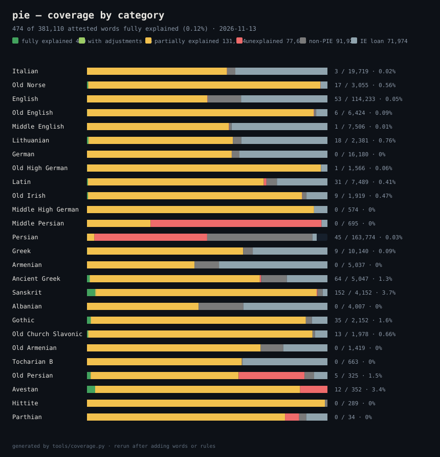

# pie — Proto-Indo-European Language Family

PIE is a rule-driven model and glossary of the Indo-European family: it aims to include every Indo-European language, every sound change as an ordered, cited rule, and every word along with its trace back through its ancestry and forward through the laws that shaped it.

## Principles

The PIE project investigates the histories of linguistic forms and adopts the following three principles:

- A linguistic form is either inherited, borrowed from another language, or created within the language. A form may be produced by combining smaller elements, e.g., roots and affixes, through morphological or grammatical processes.
- The pronunciation, meaning, grammatical function, or structure of a form may have changed over time. These changes follow patterns that may be regular within the linguistic environment; such patterns are commonly described as "laws", and do not necessarily apply to all forms.
- Each form has one or more "origins" that produce it through a combination of "laws" and processes. Any such origin is either:
  1. a form in Proto-Indo-European (PIE) itself,
  2. a form borrowed from a non-PIE language,
  3. a form created in a descendant language of PIE.

Based on these principles, the PIE project gathers all established knowledge in the literature, and enables researchers to discover and propose new terms, laws, and processes that increases our insight into the history behind the terms that we use every day.

## Repository Structure

| Path | Contents |
|------|----------|
| `data/languages.yaml` | the registry: 40 languages and proto-stages, their ancestors, dates, scripts |
| `data/rules/*.yaml` | ordered sound laws per stage transition, with contexts, examples and citations |
| `data/spelling/*.yaml` | how each stage is written (orthographic tier), scored in its own bucket |
| `data/morphology/*.yaml` | the cited derivational suffixes a stage can wear, each with its sources |
| `data/constructions/*.yaml` | rival constructions an entry argues in prose, with the quote, author and confidence |
| `proposals/` | laws and conventions that were argued for, accepted or rejected, with the reason |
| `data/review/` | matches the engine could not verify, queued for review as pages are read (working state, not committed) |
| `data/lexicon/*.jsonl.gz` | glossaries per language: form, POS, meanings, etymology, romanisation, ancestry chain |
| `data/language_names.json` | Wiktionary's English names and branches for every language code in the cognate sets |
| `data/cognate_sets/` | Proto-Indo-European etyma with the reflexes recorded across the family |
| `data/graph/edges.jsonl.gz` | word → ancestor word links |
| `src/pie/` | phonology model, rule engine, derivation traces, service layer, web app |
| `tools/` | data pipeline: Wiktionary ingest, Docling PDF conversion, rule-example checks, evaluation |
| `tests/` | engine tests, hand-curated etymology checks and the web contract (`test_web.py`) |
| `docs/` | method, formations, rule format, interface plan, roadmap, programme, review protocol, decision log, generated worklist |

## Installation

```bash
python3 -m venv .venv && . .venv/bin/activate
pip install -e .
pie serve                       # http://127.0.0.1:8100
```

The dataset lives in the repository beside the code, and every file is read and written as UTF-8. Nothing else is needed to run the interface: a stdlib HTTP server and plain HTML, CSS and JavaScript.

Parsed glossaries and the indexes built from them are kept in `~/.cache/pie`
(`PIE_CACHE_DIR` overrides it), keyed on the size and modification time of the
files they came from: editing a word or a law invalidates exactly what depends on
it, and a page is served in milliseconds instead of re-reading the corpus. The
server also reads the corpus once at start-up, in the background. Deleting the
cache costs one slow page and nothing else.

## Quick use

```bash
pie languages                          # what is modelled
pie derive --chain en "*pṓds"          # PIE → Proto-Germanic → … → English
pie derive --chain fa "*ph₂tḗr"        # PIE → PII → PIr → Old Persian → Middle Persian → Persian
pie rebuild "*nókʷts"                  # predict the etymon in every modelled language
pie rules --from ine-pro --to gem-pro  # the laws of one transition
pie lookup fa پدر                      # glossary lookup
pie stats                              # dataset overview
pie check-rules                        # validate every rule file and example
pie spell --lang en "fˈuːt"            # the orthographic layer, on its own
pie worklist                           # the next tasks, computed from the corpus
pie unverified                         # matches nobody has verified yet, queued for review
python tools/evaluate.py --from ine-pro --to gem-pro   # accuracy against Wiktionary
```

## The interface

`pie serve` opens a home page that answers three questions before you touch anything: what this is (one sentence and the numbers), what to try (three examples that land on a real word page, a derivation and a comparison), and how to use it (search → open a word → test the rules). The worked example on the front page — `*ph₂tḗr` → `pedar`, seven laws — is computed by the engine on every load, so the home page cannot drift away from the rules.

The header is **Rules** (every law, filterable by tier, one page per law), **Lab** (any form to any modelled language, with rules switchable), **Glossary** (one stage's headwords, each opening its word page), **Compare** (do two words share an etymon?), **Coverage** (the progress meter) and **About**.

Word pages are written for scripts as well as for Latin. The form is set with `dir="auto"`, so Persian and Hebrew run right to left while Greek and cuneiform do not, and non-Latin scripts are never slanted into a synthetic italic. Every such word carries a reading: the dictionary's own IPA or romanisation where it records one (پدر → *pedar · pidar · padar*), and otherwise a transliteration the script itself supplies, printed in its own colour so it can never be mistaken for a dictionary's reading.

### What a word page shows

A word page is built around its **timeline**: the word's oldest recorded ancestor at the top, the word itself at the bottom, and between them every stage the record names — each rung carrying the form the sound laws produce, the form the dictionaries record, the part of speech and sense they give it, and the years that stage was in use. The laws of each step stand on the line between two stages, with the form before and after they applied, and each one is a link to its own page and a switch: turn a law off and the chain is re-derived in place, without a reload.

When the record says how a word is built, that construction is a step of the timeline too, marked by a diamond on the rail and standing *above* the form it produces: the first piece stands immediately right of the diamond — the diamond is its mark, with no wire in between — then a line runs from that word's own right edge through `+` to the next piece, and above each piece its own timeline climbs — the same continuous rail, the same language-and-years column on the left — to a Proto-Indo-European word, to the donor it was borrowed from, or to a `???` where nothing recorded explains it. The rail never breaks: it runs unbroken from the oldest rung, through the diamond and every piece's own column, whatever the dates do to the rows' spacing. A word met on the way up that was itself built keeps its construction: *kit-ró-s stands over *keyt- + *-rós even though the dictionary states that row in its article on the word below it. Every word on that tree carries its meaning under it, in the same wording the headword's own line uses — `adj · “bright, clear, shining”` — ancestors and pieces alike; a bound suffix says what it does instead (`*-rós`: forms adjectives from Caland-system roots), because it has no word's sense — a sentence that wraps under the piece and never widens the row into its neighbour. A root that stands in another ablaut grade in the formation says so beside itself (`*ters-` **zero grade** over `*tr̥s-tó-s`) and the hover gives the reason the handbooks give: the accent is on `*-tó-`, so the root is unaccented and reduces, and a root of the shape `*CeR` loses its vowel to `*CR̥`. A bound suffix wears no dot: the line from the `+` reaches it and stops, because a dot marks a word whose own line continues above it. A record that states the word two different ways gets a tab for each analysis, labelled with the formation itself (`on + būtan`, `be + ūtan`), so one page draws the whole thing as one upside-down tree; a formation the record merely repeats at two lengths is one analysis and one line. The tree does not stop where one dictionary's entry stops: when the record quotes an ancestor form and says no more, the timeline continues through that ancestor's own ladder, so Proto-Iranian *čiθráh reaches Proto-Indo-European and the construction that built it on the same page. Nothing about a construction is printed under the headword, in Proto-Indo-European as in any other language.

Below the last stage the timeline continues into the **branch** — the languages that descend from that stage, one direct child at a time, each a door to its own page — and the word's **cognates** are listed beside it. A word borrowed from outside the chain (*dinosaur* through English, کتاب through Arabic) is drawn as the two stages the record states, with how the word travelled between them, and says so instead of inventing a Proto-Indo-European ancestry.

Every word says how it is known: **attested** when a text or a dictionary writes it in the language's own script, **recorded** when the literature reconstructs it (normally with an asterisk), **proposed** when this project guesses it, and *non-existent* when no entry is spelled that way. Beside that stands how far the model has got with it — *fully*, *partially* or not yet explained.

A source icon on a recorded form opens the page it was read on, and there is one icon per page that is actually recorded: the serifed W for the word's Wiktionary article, the open book for its dictionary entry (Dehkhoda's own page for the word on vajehyab, never the site's front page). A word whose page was never recorded carries no icon at all.

### What the colours mean

| colour | meaning |
|---|---|
| **green, softly glowing** | **attested** — the word is recorded, either in a text (Old Persian, Gothic) or in a dictionary (English, Persian) |
| **gold** | **reconstructed in the literature** — a form the field reconstructs but no text attests, normally written with an asterisk (`*nókʷts`) |
| **orange** | **rebuilt by this repo, not in the literature, and confident** — every law in the chain is `established` |
| **red** | **rebuilt by this repo, on thin evidence** — a `proposed` or `custom` law applied, no law applied at all, or the form contradicts a cognate the dictionaries do record |
| **dark red** | **non-existent** — no entry in that stage's glossary is spelled this way. The etymology names the form and the laws run from it, but the stage holds no word here, so it carries no ✓ and the line under it says *no entry for this word* |

A record the laws *almost* reach has its own state: a yellow ⚠ and the words
**match not verified**, never the ✓. Persian کبود is read *kabud* where the laws
give *kabūde* — every sound but the ending agrees, and no registered law accounts
for the difference — so the entry is quoted and the match waits for a person to
judge it. Those rows are collected in one queue (`pie unverified`, and the review
page), with both readings and both meanings beside each other.

Colour is never the only cue: hover (or focus) any form and it says what it is.

### How a word is explained

Two independent kinds of evidence are kept apart. **Ancestry** is the inheritance path a dictionary records (`foot ← Old English fōt ← Proto-West Germanic *fōt ← Proto-Germanic *fōts`), stored as data. **Rule application** is the same Proto-Indo-European etymon pushed through the ordered sound laws of the branch, with every rule that applied. They can agree or disagree, and the page shows both.

The bar is exact: a word counts as explained only when registered rules turn a PIE or an intermediate form into the attested word, character for character. Similar is not the same — no lexical links, no silently substituted forms — and a word that misses is a work item rather than a caveat.

## Progress

<!-- coverage:start -->
_Generated by `tools/coverage.py` on 2026-11-13 from all eligible words.  `identified` = a recorded ancestor exists; `reconstructed` = registered rules reproduce the attested word exactly._

```text
language                  identified         reconstructed   progress (exact / glossary)
Italian                 12,121 (54%) 1,296 / 22,278 (5.8%)   █░░░░░░░░░░░░░░░░░
Old Norse                3,035 (95%)     686 / 3,184 (22%)   ████░░░░░░░░░░░░░░
English                 37,619 (29%) 562 / 130,079 (0.43%)   ▏░░░░░░░░░░░░░░░░░
Old English              6,356 (92%)    556 / 6,931 (8.0%)   █░░░░░░░░░░░░░░░░░
Proto-Slavic             2,145 (40%)    528 / 5,388 (9.8%)   ██░░░░░░░░░░░░░░░░
Proto-Indo-Iranian         720 (90%)       350 / 799 (44%)   ████████░░░░░░░░░░
Lithuanian               1,107 (44%)     257 / 2,501 (10%)   ██░░░░░░░░░░░░░░░░
Proto-Iranian              352 (85%)       224 / 416 (54%)   ██████████░░░░░░░░
German                   8,127 (47%)   195 / 17,140 (1.1%)   ▏░░░░░░░░░░░░░░░░░
Old High German          1,571 (97%)     163 / 1,625 (10%)   ██░░░░░░░░░░░░░░░░
Latin                    3,526 (43%)    136 / 8,160 (1.7%)   ▏░░░░░░░░░░░░░░░░░
Old Irish                1,739 (87%)    107 / 2,004 (5.3%)   █░░░░░░░░░░░░░░░░░
Proto-Germanic           3,326 (56%)     95 / 5,908 (1.6%)   ▏░░░░░░░░░░░░░░░░░
Middle Persian             113 (16%)       3 / 695 (0.43%)   ▏░░░░░░░░░░░░░░░░░
Persian                 2,301 (1.4%)      0 / 164,823 (0%)   ░░░░░░░░░░░░░░░░░░
Greek                    5,090 (49%)       0 / 10,471 (0%)   ░░░░░░░░░░░░░░░░░░
```

**By the bands: 480 fully explained, 54 with approved adjustments, 131,725 partially explained and waiting for a law, 77,633 with no recorded etymology, 91,918 non-PIE** — plus 71,976 recorded loans from a sister branch, counted in the same total and never in green — and 7,324 words the record does not analyse but whose own language's words do (a formation, never a derivation, so never green either).

**6,430 of 426,395 glossary entries reconstructed exactly (1.5%; 978 of them straight from the PIE etymon); 114,513 have a recorded ancestor and 47,397 reach a recorded PIE etymon.** The orthographic layer adds 5,103 more spellings (12,109 in total, 2.8%) — reported separately, because a writing convention is not a sound law. 1,438 more are reached through a language's own writing system (Old Persian cuneiform: the laws produce *wˈarkah* and the monument writes 𐎺𐎼𐎣) — counted apart, because the signs do not spell every sound (a syllabary leaves a final /h/ to the reader, an abjad the short vowels). 12 further words are completed by a word's own recorded pathway (a law that does not apply to it, with the reason stored) — also counted apart, never added. The percentage moves as words and rules are added — that is the point. Full table: [`docs/COVERAGE.md`](docs/COVERAGE.md).


<!-- coverage:end -->

## Data and licences

Wiktionary-derived material (glosses, etymologies, ancestry) is CC BY-SA 4.0 and comes from the [kaikki.org](https://kaikki.org) Wiktextract dumps. Rule descriptions cite the standard literature; see `docs/SOURCES.md`. The code is GPL-3.0, matching the repository licence.
