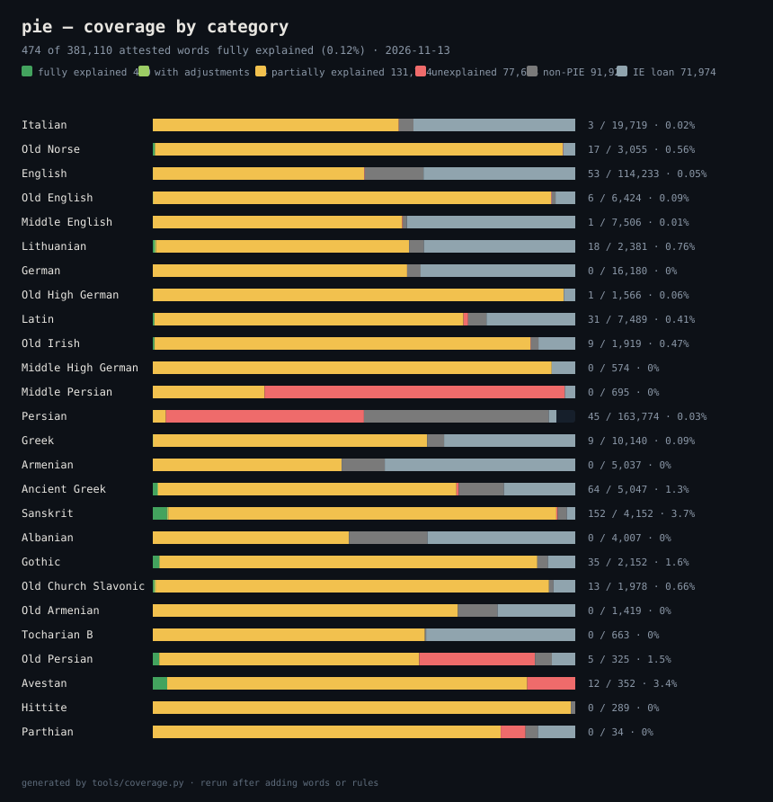

# Exact-derivation coverage

Generated by `tools/coverage.py` on 2026-11-13.  A word counts as **reconstructed** only when a registered
rule chain turns an ancestor form into the attested word, character for character.
The chain may start at the PIE etymon **or at any ancestor recorded in the word's
inheritance chain**; approximations are reported as misses, never as matches.

## The bands

Every attested word in the glossary is counted once, so the shares below add up
to 100%.  Five bands say how far the model explains it: **full**, **adjusted**,
**partial**, **unexplained**, **non-PIE**.  Two facets are counted in the same
total and are never green: `ie_loan` (a borrowing from another IE branch —
recorded, inside the family, and not derived here) and `built` (a formation
from the stage's own words — knowledge about the word, never a derivation).
`unidentified` estimates the words the glossary does not hold yet, so it is
never a count and never in a denominator.

| band | words | share | definition |
|---|---:|---:|---|
| **fully explained** (dark green) | 334 | 0.1% | A recorded origin — a PIE etymon carried by cited laws, or the record's own registered construction of explained pieces — reproduced exactly, every recorded intermediate matching. |
| **fully explained, with adjustments** (light green) | 50 | 0.0% | The same path, but a recorded intermediate disagrees, or one step is an approved adjustment of ours. |
| **partially explained** (yellow) | 131,881 | 33.2% | A recorded chain that does not reach the word from the PIE etymon in full: it starts lower, a recorded rung has no entry, or the laws do not reproduce it. |
| **unexplained** (red) | 89,174 | 22.4% | No recorded etymology. |
| **non-PIE** (dark grey) | 95,828 | 24.1% | Recorded as borrowed from outside the family. |
| **loan from another IE language** (blue grey) | 72,037 | 18.1% | Borrowed from a sister branch; recorded, not derived by this chain. |
| **built from its own words** (brown) | 8,154 | 2.0% | Made of the language's own words, or of one plus a suffix: a formation, not a derivation. |

**384 of 397,458 attested words are fully explained (0.10%), and 72,037 more are recorded loans from a
sister branch. Both greens need a recorded origin carried all the way to the
word — by cited laws, or by the record's own registered construction (the
pieces spell it, each piece starts from a PIE etymon or from outside the
family, and no recorded step disagrees). Light green is reached when a recorded
intermediate stage disagrees, or when a change of ours is needed — never
applied by the counter without a report for the law and one for the word in
`data/adjusted.yaml`, and approval. A word reproduced only from a later
ancestor (Old Persian 𐎣𐎠𐎶 from Proto-Iranian) is yellow.

### By language

| language | full | adjusted | partial | unexplained | non-PIE | IE loan | built | in review | explained | stored |
|---|---:|---:|---:|---:|---:|---:|---:|---:|---:|---:|
| Sanskrit (`sa`) | 129 | 14 | 3,823 | 14 | 90 | 82 | 0 | 4,081 | 143 | 4,152 |
| Ancient Greek (`grc`) | 50 | 8 | 3,569 | 29 | 539 | 852 | 0 | 4,122 | 58 | 5,047 |
| Persian (`fa`) | 48 | 0 | 5,050 | 71,951 | 75,600 | 2,979 | 8,149 | 2,091 | 48 | 163,777 |
| Latin (`la`) | 29 | 2 | 5,477 | 81 | 328 | 1,572 | 0 | 5,138 | 31 | 7,489 |
| Lithuanian (`lt`) | 10 | 8 | 1,427 | 0 | 83 | 853 | 0 | 1,207 | 18 | 2,381 |
| Avestan (`ave`) | 12 | 0 | 300 | 40 | 0 | 0 | 0 | 103 | 12 | 352 |
| Old Church Slavonic (`chu`) | 6 | 6 | 1,843 | 0 | 21 | 102 | 0 | 628 | 12 | 1,978 |
| Old Norse (`non`) | 10 | 1 | 2,954 | 1 | 4 | 85 | 0 | 2,084 | 11 | 3,055 |
| English (`en`) | 10 | 0 | 57,175 | 104 | 15,924 | 41,017 | 3 | 31,181 | 10 | 114,233 |
| Old Irish (`sga`) | 8 | 2 | 1,706 | 1 | 35 | 167 | 0 | 1,537 | 10 | 1,919 |
| Greek (`el`) | 5 | 4 | 6,577 | 0 | 407 | 3,147 | 0 | 5,240 | 9 | 10,140 |
| Gothic (`got`) | 8 | 1 | 1,950 | 0 | 54 | 139 | 0 | 1,030 | 9 | 2,152 |
| Old English (`ang`) | 4 | 2 | 6,049 | 7 | 63 | 299 | 0 | 3,634 | 6 | 6,424 |
| Old Persian (`peo`) | 4 | 0 | 201 | 92 | 13 | 18 | 0 | 157 | 4 | 328 |
| Italian (`it`) | 0 | 2 | 11,480 | 7 | 680 | 7,550 | 0 | 14,529 | 2 | 19,719 |
| Old High German (`goh`) | 1 | 0 | 1,522 | 0 | 2 | 41 | 0 | 641 | 1 | 1,566 |
| German (`de`) | 0 | 0 | 9,739 | 3 | 515 | 5,923 | 0 | 6,521 | 0 | 16,180 |
| Middle English (`enm`) | 0 | 0 | 4,431 | 11 | 72 | 2,992 | 0 | 3,084 | 0 | 7,506 |
| Middle High German (`gmh`) | 0 | 0 | 542 | 0 | 0 | 32 | 0 | 185 | 0 | 574 |
| Hittite (`hit`) | 0 | 0 | 286 | 0 | 3 | 0 | 0 | 289 | 0 | 289 |
| Armenian (`hy`) | 0 | 0 | 2,252 | 0 | 514 | 2,271 | 0 | 231 | 0 | 5,037 |
| Middle Persian (`pal`) | 0 | 0 | 187 | 16,831 | 0 | 17 | 2 | 61 | 0 | 17,037 |
| Albanian (`sq`) | 0 | 0 | 1,861 | 0 | 745 | 1,401 | 0 | 1,847 | 0 | 4,007 |
| Tocharian B (`txb`) | 0 | 0 | 427 | 0 | 2 | 234 | 0 | 507 | 0 | 663 |
| Old Armenian (`xcl`) | 0 | 0 | 1,025 | 0 | 133 | 261 | 0 | 1,159 | 0 | 1,419 |
| Parthian (`xpr`) | 0 | 0 | 28 | 2 | 1 | 3 | 0 | 1 | 0 | 34 |

## What a language is thought to hold

The grey band is the difference between a language's estimated vocabulary and the
words this glossary holds. It is printed apart from every count, because it is not a
measurement: it is somebody's figure for how many words exist, and the figures are
not the same kind of thing. A dictionary's headword count is what one dictionary
collected; a *floor* is a dictionary that says outright it covers only a core; an
*upper bound* includes phrases or inflected forms and overstates lemmas. Each row
below names its source and quotes it, and a language with no cited figure reports
no grey band at all (`data/vocabulary_estimates.yaml`).

| language | estimated | not in the glossary | what the figure counts | source |
|---|---:|---:|---|---|
| English (`en`) | 500,000 | 385,767 | words and phrases, current and historical — not lemmas only, and phrases count (upper) | [Oxford English Dictionary (OED online), front page](https://www.oed.com/), 2026 |
| Lithuanian (`lt`) | 500,000 | 497,619 | leksikografiniai straipsniai (lexicographic articles), dialect vocabulary included, quoted 1547–2001 (upper) | [Lietuvių kalbos žodynas (LKŽ, 20 volumes), described on Lithuanian Wikipedia](https://lt.wikipedia.org/wiki/Lietuvi%C5%B3_kalbos_%C5%BEodynas), 2002 |
| Persian (`fa`) | 160,802 words (of 343,466 entries) | 0 | dictionary entries of the Dehkhoda dictionary; it is the largest Persian dictionary, and its entries include compounds and phrases (dictionary) | [Dehkhoda Dictionary (Loghatnāmeh), digital edition, as described by the Association for Iranian Studies](https://associationforiranianstudies.org/resources), 1931 |
| Sanskrit (`sa`) | 180,000 | 175,848 | words (the dictionary's own headword count) (dictionary) | [M. Monier-Williams, A Sanskrit–English Dictionary (1899), publisher's description](https://books.google.com/books/about/Sanskrit_English_Dictionary.html?id=rhRhAQAACAAJ), 1899 |
| German (`de`) | 151,000 | 134,820 | Stichwörter (headwords) of contemporary standard German (dictionary) | [Duden — Die deutsche Rechtschreibung, 29th edition (2024), edition history](https://www.duden.de/ueber_duden/auflagengeschichte), 2024 |
| Italian (`it`) | 145,000 | 125,281 | voci (headwords); the same volume carries 380,000 senses (dictionary) | [Lo Zingarelli 2024, Vocabolario della lingua italiana (Zanichelli)](https://www.zanichelli.it/ricerca/prodotti/lo-zingarelli-2024), 2024 |
| Greek (`el`) | 140,000 | 129,860 | λήμματα (lemmas) in the electronic database; the printed volume develops 75,500 of them (dictionary) | [Χρηστικό Λεξικό της Νεοελληνικής Γλώσσας (Academy of Athens, electronic edition)](https://christikolexiko.academyofathens.gr), 2023 |
| Albanian (`sq`) | 120,000 | 115,993 | words the dictionary will hold; the figure was announced before the print edition (dictionary) | [Fjalori i madh i gjuhës shqipe (2024), reported by fjala.info](https://fjala.info/ne-nentor-2024-publikohet-fjalori-me-i-madh-i-gjuhes-shqipe-fillimisht-ne-internet/), 2024 |
| Ancient Greek (`grc`) | 116,502 | 111,455 | entries (headwords) of literary and documentary Ancient Greek (dictionary) | [Liddell–Scott–Jones, A Greek–English Lexicon, 9th edition (1940), as summarised in its Wikipedia article](https://en.wikipedia.org/wiki/A_Greek%E2%80%93English_Lexicon), 1940 |
| Latin (`la`) | 40,000 | 32,511 | headword entries of Classical Latin (to AD 200), covering 100,000 senses (dictionary) | [Oxford Latin Dictionary, 2nd edition (OUP 2012), as summarised in its Wikipedia article](https://en.wikipedia.org/wiki/Oxford_Latin_Dictionary), 2012 |
| Avestan (`ave`) | 7,959 | 7,607 | dictionary entries (lemmas) of the standard Avestan dictionary (dictionary) | [Chr. Bartholomae, Altiranisches Wörterbuch (1904), digitised as the CAB edition (FU Berlin)](https://cab.geschkult.fu-berlin.de/dictionaries/Bartholomae_Dictionary.html), 1904 |
| Middle Persian (`pal`) | 4,000 | 0 | the commonest simple words a concise dictionary sets out to cover — a curated core, not the attested vocabulary (floor) | [D. N. MacKenzie, A Concise Pahlavi Dictionary (OUP 1971), preface](https://www.parsianjoman.org/wp-content/uploads/2015/09/A-Concise-Pahlavi-Dictionary.pdf), 1971 |

Every figure above was read on the page it cites on 2026-11-09; the quotation for
each one lives with the number in `data/vocabulary_estimates.yaml`, together with the
candidates that were looked for and rejected.

## The layers behind the bands

**identified** = the entry has a recorded ancestor at a modelled stage.
**PIE-linked** = the entry's recorded ancestry reaches Proto-Indo-European.
**created as borrowed** = the record marks the etymon borrowed (`:bor` and family).
**other source** = the record names an ancestor outside the word's modelled chain
  (Latin into English, Arabic into Persian) without a borrowing keyword.
**cited as stem** = the laws produce the word in another grammatical form and the
dictionary cites the stem (`data/citation/sa.yaml`; the difference is the citation, not
a sound change, so it is counted apart from both the laws and the spelling).

**explained** = the union of the layers: reconstructed by the laws, a stored pathway,
  spelled by the writing conventions, or reached through the language's own script.
**reconstructed** = the registered rules reproduce the attested form exactly.
  Stress is notation and not a difference: the dictionaries print an acute
  (*waydáyati*) where the engine writes its own token (*waydˈayati*), and the
  word page has always called those one form (`service._same_form`).  Every
  letter, length and macron still has to agree; the strict string count is kept
  in `data/coverage.json` as `exact_strict`.
**+ orthography** = those plus the words the writing conventions (`data/spelling/`) spell correctly.  The two are reported apart on purpose:
spelling is not a sound law, and a number that mixed them could not be compared
with an older release.
**unchanged** = the ancestor needs no change at all and the laws' form (which had
  nothing to do) equals the record modulo its accent.  **bound form** = the record
  writes the same form with a morpheme hyphen the laws never write (`a-`, `-kas`).
  Both are counted apart: in neither did a rule demonstrate anything.

Corpus: **442,865 glossary entries**, 114,516 with a recorded ancestor,
**6,420 reconstructed exactly**, of which **971 start at the
PIE etymon** (1.4% of the whole glossary,
12,101 once the orthographic layer is allowed (2.7%),
5.6% of words with a recorded ancestor; 47,392 reach a PIE etymon).  Rules used: all; sample: all eligible words.

**12 more** are completed by a word's own recorded pathway — a
registered law that does not apply to that word, with the reason stored beside it
(`data/pathways.jsonl`). They are counted apart and never added to the figure above:
a per-word exception must be visible, not silent.

**1,389 more** are reached through a language's own writing system, out of
the words written in a script with a table in `data/script/` (Old Persian: the laws
produce *wˈarkah* and the monument writes 𐎺𐎼𐎣, *va-ra-ka*). The signs do not spell
every sound: a syllabary leaves a final /h/ unwritten and closes a final -i with a y-sign
that adds no sound (𐎠𐎡𐎫𐎡𐎹 *a-i-t-i-y* is /aiti/), and an abjad leaves the short vowels
to the reader, so such a word is a **reading** of the spelling rather than the same
string; it is counted apart and never added to the figure above, which stays a claim
about the dictionary's own spelling (2026-11-08).

**38 more** reproduce a form the glossary itself
marks as a **reconstruction** (Wiktionary's `Reconstruction:` namespace), out of
569 reconstruction entries with a recorded ancestor.
They are counted apart and never added:
a reconstruction is not a word a text spells, and a figure of *attested* forms that
included one could not be checked against the record (2026-11-08).

| language | identified | PIE-linked | borrowed | other source | reconstructed (laws) | + orthography | cited as stem | unchanged | bound form | through its script | built from pieces | explained | glossary | progress (explained / glossary) |
|---|---:|---:|---:|---:|---:|---:|---:|---:|---:|---:|---:|---:|---:|---|
| Italian (`it`) | 54% (12,121) | 1,562 | 4,148 | 3,068 | **1,296** | 378 | — | 123 | 64 | — | 994 | 1,861 | 22,278 | `█░░░░░░░░░░░░░` 8.4% |
| Old Norse (`non`) | 95% (3,035) | 1,396 | 68 | 75 | **686** | 0 | — | 9 | 15 | — | 303 | 710 | 3,184 | `███░░░░░░░░░░░` 22% |
| Proto-West Germanic (`gmw-pro`) | 65% (3,653) | 733 | 247 | 14 | **596** | 0 | — | 38 | 29 | — | 887 | 663 | 5,585 | `██░░░░░░░░░░░░` 12% |
| English (`en`) | 29% (37,619) | 14,887 | 55,903 | 24,638 | **562** | 1,337 | — | 1052 | 76 | — | 8166 | 3,029 | 130,079 | `▏░░░░░░░░░░░░░` 2.3% |
| Old English (`ang`) | 92% (6,356) | 1,302 | 309 | 175 | **555** | 535 | — | 96 | 41 | — | 1107 | 1,227 | 6,931 | `██░░░░░░░░░░░░` 18% |
| Proto-Slavic (`sla-pro`) | 40% (2,145) | 1,969 | 53 | 43 | **526** | 0 | — | — | 49 | — | 387 | 575 | 5,388 | `█░░░░░░░░░░░░░` 11% |
| Middle English (`enm`) | 59% (4,722) | 580 | 2,964 | 285 | **386** | 471 | — | 119 | 31 | — | 1206 | 1,007 | 8,053 | `██░░░░░░░░░░░░` 13% |
| Proto-Indo-Iranian (`iir-pro`) | 90% (720) | 720 | 0 | 0 | **346** | 0 | — | 2 | 40 | — | 32 | 388 | 799 | `███████░░░░░░░` 49% |
| Lithuanian (`lt`) | 44% (1,107) | 910 | 1,011 | 367 | **257** | 0 | — | 28 | 11 | — | 28 | 296 | 2,501 | `██░░░░░░░░░░░░` 12% |
| Proto-Iranian (`ira-pro`) | 84% (353) | 236 | 1 | 0 | **224** | 0 | — | 21 | 11 | — | 57 | 256 | 418 | `█████████░░░░░` 61% |
| German (`de`) | 47% (8,127) | 1,117 | 6,237 | 2,584 | **193** | 167 | — | 603 | 38 | — | 1751 | 1,001 | 17,140 | `█░░░░░░░░░░░░░` 5.8% |
| Old High German (`goh`) | 97% (1,571) | 230 | 41 | 10 | **162** | 7 | — | 58 | 3 | — | 231 | 230 | 1,625 | `██░░░░░░░░░░░░` 14% |
| Proto-Celtic (`cel-pro`) | 71% (1,149) | 1,149 | 6 | 0 | **148** | 0 | — | 37 | 27 | — | 80 | 212 | 1,613 | `██░░░░░░░░░░░░` 13% |
| Latin (`la`) | 43% (3,526) | 3,225 | 1,783 | 1,552 | **135** | 213 | — | 39 | 26 | — | 527 | 413 | 8,160 | `█░░░░░░░░░░░░░` 5.1% |
| Old Irish (`sga`) | 87% (1,739) | 1,264 | 171 | 86 | **107** | 66 | — | 5 | 9 | — | 294 | 187 | 2,004 | `█░░░░░░░░░░░░░` 9.3% |
| Middle High German (`gmh`) | 92% (533) | 43 | 29 | 3 | **96** | 29 | — | 33 | 1 | — | 24 | 159 | 580 | `████░░░░░░░░░░` 27% |
| Proto-Germanic (`gem-pro`) | 56% (3,326) | 3,326 | 30 | 7 | **95** | 0 | — | 2 | 21 | — | 516 | 118 | 5,908 | `▏░░░░░░░░░░░░░` 2.0% |
| Proto-Balto-Slavic (`ine-bsl-pro`) | 92% (454) | 454 | 1 | 0 | **46** | 0 | — | 3 | 3 | — | 8 | 52 | 491 | `█░░░░░░░░░░░░░` 11% |
| Middle Persian (`pal`) | 0.67% (115) | 36 | 16 | 0 | **4** | 0 | — | — | — | 8 | 4 | 12 | 17,153 | `▏░░░░░░░░░░░░░` 0.07% |
| Persian (`fa`) | 1.4% (2,301) | 862 | 5,496 | 669 | **0** | 139 | — | 229 | — | 421 | 199 | 796 | 164,827 | `▏░░░░░░░░░░░░░` 0.48% |
| Greek (`el`) | 49% (5,090) | 312 | 2,174 | 1,370 | **0** | 647 | — | 317 | — | — | 545 | 964 | 10,471 | `█░░░░░░░░░░░░░` 9.2% |
| Armenian (`hy`) | 1.2% (64) | 64 | 2,859 | 2,400 | **0** | 0 | — | — | — | — | — | 0 | 5,398 | `░░░░░░░░░░░░░░` 0% |
| Ancient Greek (`grc`) | 64% (3,323) | 3,233 | 1,212 | 198 | **0** | 294 | — | 81 | — | — | 563 | 375 | 5,222 | `█░░░░░░░░░░░░░` 7.2% |
| Sanskrit (`sa`) | 83% (4,218) | 3,764 | 104 | 63 | **0** | 520 | 541 | 36 | — | — | 654 | 1,097 | 5,059 | `███░░░░░░░░░░░` 22% |
| Albanian (`sq`) | 29% (1,216) | 1,216 | 2,224 | 801 | **0** | 0 | — | — | — | — | 60 | 0 | 4,256 | `░░░░░░░░░░░░░░` 0% |
| Gothic (`got`) | 87% (1,976) | 674 | 186 | 82 | **0** | 278 | — | 30 | — | — | 575 | 308 | 2,263 | `██░░░░░░░░░░░░` 14% |
| Old Church Slavonic (`chu`) | 90% (1,802) | 278 | 116 | 77 | **0** | 0 | — | 402 | — | 921 | 142 | 1,323 | 1,999 | `█████████░░░░░` 66% |
| Old Armenian (`xcl`) | 59% (920) | 920 | 379 | 245 | **0** | 0 | — | — | — | — | 81 | 0 | 1,564 | `░░░░░░░░░░░░░░` 0% |
| Tocharian B (`txb`) | 63% (442) | 398 | 241 | 14 | **0** | 0 | — | — | — | — | 23 | 0 | 697 | `░░░░░░░░░░░░░░` 0% |
| Old Persian (`peo`) | 40% (215) | 101 | 29 | 5 | **0** | 0 | — | 1 | — | 39 | 7 | 43 | 535 | `█░░░░░░░░░░░░░` 8.0% |
| Avestan (`ave`) | 89% (312) | 195 | 0 | 0 | **0** | 26 | 33 | 1 | — | — | — | 60 | 352 | `██░░░░░░░░░░░░` 17% |
| Hittite (`hit`) | 85% (253) | 235 | 1 | 2 | **0** | 0 | — | — | — | — | 11 | 0 | 298 | `░░░░░░░░░░░░░░` 0% |
| Parthian (`xpr`) | 38% (13) | 1 | 4 | 0 | **0** | 0 | — | — | — | — | — | 0 | 34 | `░░░░░░░░░░░░░░` 0% |
| Oscan (`osc`) | 0% (0) | 0 | 0 | 0 | **0** | 0 | — | — | — | — | — | 0 | 0 | `░░░░░░░░░░░░░░` 0% |
| Proto-Indo-Aryan (`inc-pro`) | 0% (0) | 0 | 0 | 0 | **0** | 0 | — | — | — | — | — | 0 | 0 | `░░░░░░░░░░░░░░` 0% |
| Proto-Tocharian (`ine-toc-pro`) | 0% (0) | 0 | 0 | 0 | **0** | 0 | — | — | — | — | — | 0 | 0 | `░░░░░░░░░░░░░░` 0% |

Glossaries with 0 identified words (for example Avestan and Middle Persian)
have no ancestry links in the current data, so they are a data gap, not a rule
failure.  They enter the metric as soon as their Wiktionary/MacKenzie entries
are connected to an ancestor.

## Rules used in successful reconstructions

A rule that never applies in an exact derivation is unused, blocked by an earlier
rule, or waiting for the orthography/morphology layers.  Counts come from the
exact derivations above; use them to compare rule sets and to spot rules that
apply often but never contribute to a match.

| rule | transition | tier | applications |
|---|---|---|---:|
| `final_z_loss` Word-final *-z is lost | gem-pro → gmw-pro | established | 936 |
| `u_to_o` Short *u > *o | la → it | established | 936 |
| `final_s_loss` Final *-s is lost | la → it | established | 897 |
| `final_a_loss` Final short *-a is lost | gem-pro → gmw-pro | established | 678 |
| `final_e_loss` Final *-e is lost | enm → en | established | 450 |
| `vowel_merger_a` *e, *o and *a merge as *a | ine-pro → iir-pro | established | 381 |
| `long_a_to_a` Long *ā > *a | la → it | established | 316 |
| `stress_token_dropped` Stress is notation and is not written in the PSl lemma | ine-bsl-pro → sla-pro | orthographic | 277 |
| `brightening` Anglo-Frisian brightening: *a > *æ | gmw-pro → ang | established | 241 |
| `final_a_to_e` Final *-a > *-e | ang → enm | established | 234 |
| `register_mark_dropped` The acute register mark *ˀ is notation, not a PSl segment | ine-bsl-pro → sla-pro | orthographic | 234 |
| `long_i_to_i` Long *ī > *i | la → it | established | 233 |
| `final_ą_to_a` Final *-ą > *-a | gmw-pro → ang | established | 227 |
| `final_a_loss` Final *-a is lost | gmw-pro → ang | established | 227 |
| `long_o_to_o` Long *ō > *o | la → it | established | 196 |
| `final_az_to_r` *-az > -r | gem-pro → non | established | 191 |
| `stress_token_dropped` Stress is notation and is not written in the Lithuanian headword | ine-bsl-pro → lt | orthographic | 184 |
| `laryngeal_to_H` Laryngeals are preserved as *H | ine-pro → iir-pro | established | 176 |
| `final_as_to_yer` Final *-as > *-ъ | ine-bsl-pro → sla-pro | established | 172 |
| `long_u_to_u` Long *ū > *u | la → it | established | 169 |
| `long_e_to_e` Long *ē > *e | la → it | established | 149 |
| `ei_to_i` *ei > *i | ine-bsl-pro → sla-pro | established | 148 |
| `short_a_to_o` Short *a > *o | ine-bsl-pro → sla-pro | established | 146 |
| `final_is_to_e` Final *-is becomes *-e | la → it | established | 141 |
| `breaking_ae_rc` Breaking: *æ > *ea before *r or *l + consonant | gmw-pro → ang | established | 137 |
| `unstressed_a` Unstressed *a > *e | goh → gmh | established | 128 |
| `o_to_a` *o > *a | ine-pro → ine-bsl-pro | established | 128 |
| `long_a_to_a` *ā > *a | ine-bsl-pro → sla-pro | established | 127 |
| `register_mark_dropped` The acute register mark *ˀ is notation, not a Lithuanian segment | ine-bsl-pro → lt | orthographic | 125 |
| `final_m_loss` Final *-m is lost | la → it | established | 119 |
| `final_s_to_h` Final *-Vs > PIr *-Vh | iir-pro → ira-pro | established | 112 |
| `final_ōn_to_ian` Final *-ōn > *-ian | gmw-pro → ang | proposed | 97 |
| `w_to_v` *w > *v | ine-bsl-pro → sla-pro | established | 96 |
| `infinitive_aną` Strong infinitive *-aną > -a | gem-pro → non | established | 91 |
| `final_ei_to_i_after_t` The infinitive ending *-tei > -ti | ine-bsl-pro → lt | established | 91 |
| `laryngeal_loss` Laryngeals are lost | ine-pro → cel-pro | established | 88 |
| `w_to_v` *w > v | gem-pro → non | established | 86 |
| `ruki_s` RUKI: *s > *š after r, u, k, i (and the glides and satem affricates) | ine-pro → iir-pro | established | 84 |
| `final_o_to_u_s` Final *-os > -us | itc-pro → la | established | 81 |
| `ai_to_ei` *ai > ei | gem-pro → non | established | 80 |
| `u_lowering` Short *u > *o before *a | gem-pro → gmw-pro | established | 78 |
| `i_umlaut_a` i-umlaut: *a > e before *i or *j | gem-pro → non | established | 75 |
| `laryngeal_loss` Laryngeals are lost | ine-pro → ine-bsl-pro | established | 74 |
| `final_ą_loss` Word-final *-ą is lost | gem-pro → non | established | 73 |
| `diph_u` NHG diphthongisation: *ū > *au | gmh → de | established | 70 |
| `o_to_a` *o merges into *a | ine-pro → gem-pro | established | 67 |
| `satem_k` Satem: *ḱ > *ć [tɕ], the first affricate | ine-pro → iir-pro | established | 64 |
| `d_to_t` HGCS: *d > *t | gmw-pro → goh | established | 62 |
| `h_loss` Latin *h is lost | la → it | established | 62 |
| `umlaut_u` i-umlaut: *u > *y | gmw-pro → ang | established | 61 |
| `final_i_deletion_cluster` Final *-i is lost after a heavy consonant cluster | gmw-pro → ang | established | 60 |
| `d_to_eth` *d > ð after a vowel | gem-pro → non | established | 60 |
| `final_ô_to_a` Final *-ô > *-a | gmw-pro → ang | established | 59 |
| `final_u_deletion_cluster` Final *-u is lost after a heavy cluster | gmw-pro → ang | established | 58 |
| `final_os_loss` Final *-os is lost | cel-pro → sga | established | 58 |
| `y_to_i` OE *y > ME *i | ang → enm | established | 57 |
| `infinitive_janą` Light class-1 infinitive *-janą > -ja | gem-pro → non | established | 57 |
| `ea_to_a` OE *ea > ME *a | ang → enm | established | 56 |
| `ian_to_en` OE *-ian > ME *-en | ang → enm | proposed | 56 |
| `j_loss` *j is lost after a consonant | gmw-pro → ang | established | 54 |
| `final_u_loss_cluster` Final *-u is lost after a short vowel and two consonants | gem-pro → non | established | 54 |
| `long_i_to_i` *ī > *i | ine-bsl-pro → sla-pro | established | 54 |
| `short_i_to_yer` Short *i > *ь | ine-bsl-pro → sla-pro | established | 54 |
| `eo_to_e` OE *eo > ME *e | ang → enm | established | 52 |
| `final_ō_to_u` Word-final *-ō > -u | gem-pro → non | established | 52 |
| `final_i_lowering` Final *-i > *-e after a light syllable | gmw-pro → ang | established | 50 |
| `verner_s` Verner: *s > *z (after unstressed syllable) | ine-pro → gem-pro | established | 49 |
| `u_umlaut_a` u-umlaut: *a > ǫ before *u | gem-pro → non | established | 49 |
| `au_to_u` *au > *u | ine-bsl-pro → sla-pro | established | 46 |
| `w_to_v` *w > v | ine-bsl-pro → lt | established | 44 |
| `final_u_to_e` Final *-u > *-e | ang → enm | established | 43 |
| `final_ǭ_to_a` Word-final *-ǭ > -a | gem-pro → non | established | 43 |
| `final_is_to_yer` Final *-is > *-ь | ine-bsl-pro → sla-pro | established | 43 |
| `laryngeal_loss` Laryngeals are lost | ine-pro → gem-pro | established | 42 |
| `infinitive_ijaną` Heavy class-1 infinitive *-ijaną > -a | gem-pro → non | established | 42 |
| `c_from_palatal` PII *ć > PIr *c [ts] | iir-pro → ira-pro | established | 42 |
| `thorn_to_d` *θ > *d | gmw-pro → goh | established | 41 |
| `palatal_z_to_z` PBS *ź > *z | ine-bsl-pro → sla-pro | established | 40 |
| `long_a_to_a_final` Final *-ā > -a | ine-bsl-pro → lt | established | 39 |
| `final_ô_to_i` Word-final *-ô > -i in the weak masculine | gem-pro → non | proposed | 38 |
